# Keemfinity Effects

**48 video effects for Claude.** Drop in a talking-head clip, type `/effects` and a name, and Claude does the edit. No editing app, no timeline, no templates.


Made by **Keemfinity** · [@keemfinity](https://instagram.com/keemfinity)

---

## Get it in 30 seconds

Paste this into your terminal (Mac, Linux, or Git Bash on Windows):

```bash
git clone https://github.com/keemfinity/keemfinity-effects ~/.claude/skills/effects
```

Restart Claude Code, and `/effects` is ready.

Not a terminal person? Open Claude Code and say: **"Install the skill from github.com/keemfinity/keemfinity-effects into ~/.claude/skills/effects"**. Claude installs it for you.

## Your first edit

Drag a video into Claude Code and ask for what you want:

```
/effects red-collage for the first 2 seconds, word KEEM
/effects led-sign when I say "lights out"
/effects orbit from 4 to 7 seconds with my reels from ./screenshots
/effects messages at the end
```

Claude finds the timing, checks a few frames so nothing covers your face, then renders `yourvideo_effects.mp4` next to your original, with your audio untouched. The first run sets itself up (Python and ffmpeg); give it two minutes.

Stack as many as you like in one sentence: *"red-collage at the start, then glass-widgets, then place-in-grid on the last line."*

## The 48 effects

Every effect tracks your face. Text and graphics slide behind your head instead of over it.

### Camera & Light
Move the camera, change the light, change the mood.

<table>
<tr><td align="center" valign="top" width="25%">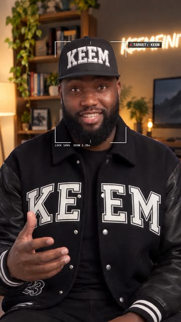<br><code>locked-on</code><br><sub>Brackets snap onto your face and the camera tracks you</sub></td><td align="center" valign="top" width="25%"><br><code>lean-in</code><br><sub>A hard punch-in on one word</sub></td><td align="center" valign="top" width="25%"><br><code>slow-push</code><br><sub>A slow cinematic push to your face while the room melts away</sub></td><td align="center" valign="top" width="25%"><br><code>over-the-shoulder-zoom</code><br><sub>The camera dives into one corner with a glass graph, then the other corner with a second graph</sub></td></tr>
<tr><td align="center" valign="top" width="25%">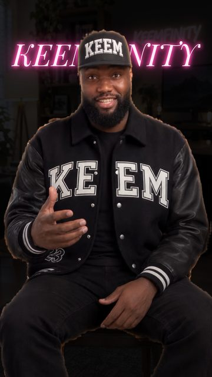<br><code>spotlight</code><br><sub>Lights out, you stay lit, a glowing word behind you</sub></td><td align="center" valign="top" width="25%">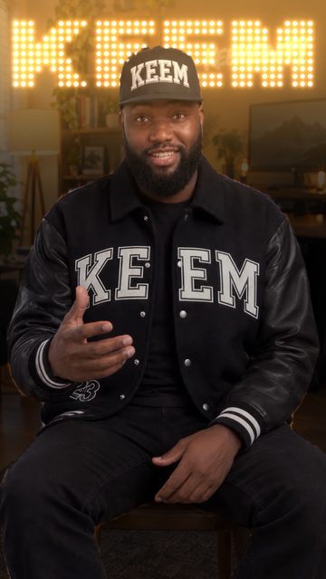<br><code>led-sign</code><br><sub>The room goes dark and an LED bulb sign types your word behind you</sub></td><td align="center" valign="top" width="25%">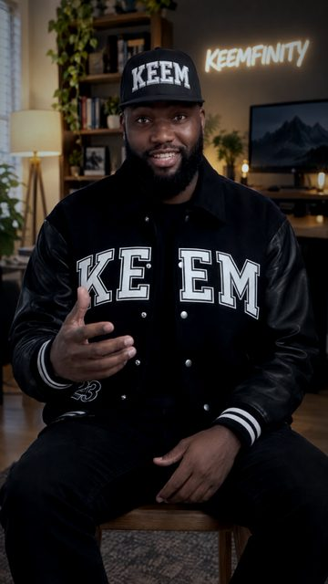<br><code>moody</code><br><sub>One-tap colour grade: moody, black and white, warm, cool or pop</sub></td><td align="center" valign="top" width="25%">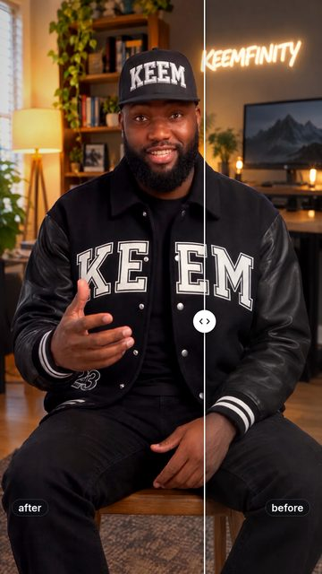<br><code>swipe</code><br><sub>A before/after slider wipes across you</sub></td></tr>
<tr><td align="center" valign="top" width="25%">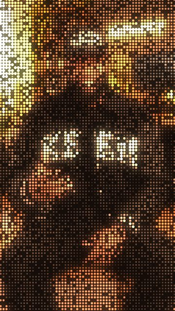<br><code>dot-reveal</code><br><sub>Your shot assembles itself out of glowing dots</sub></td><td align="center" valign="top" width="25%">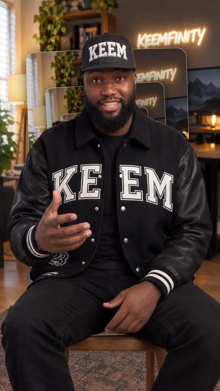<br><code>rabbit-hole</code><br><sub>The frame tunnels into itself and spins</sub></td></tr>
</table>

### Words Behind You
Big type that sits behind your head, never over your face.

<table>
<tr><td align="center" valign="top" width="25%">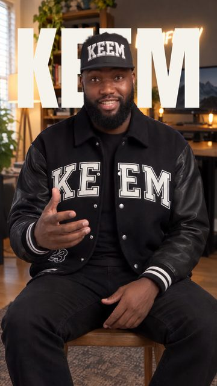<br><code>backdrop-word</code><br><sub>One giant word drops in behind you</sub></td><td align="center" valign="top" width="25%">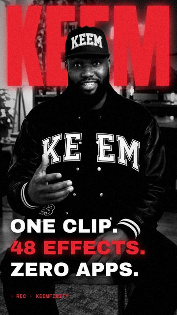<br><code>red-collage</code><br><sub>Black-and-white you, a red word behind, three lines slam in</sub></td><td align="center" valign="top" width="25%"><br><code>pastel-word</code><br><sub>A lavender set, a giant word, and a profile card that gets followed</sub></td><td align="center" valign="top" width="25%">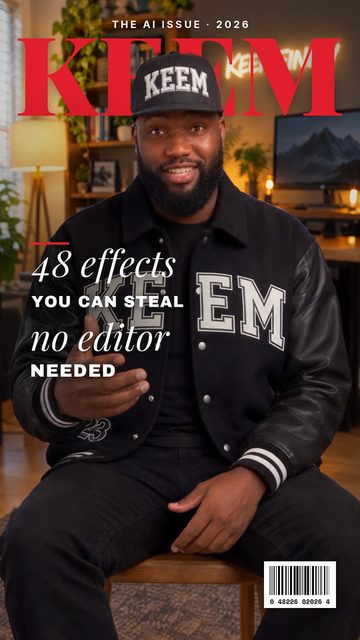<br><code>cover-star</code><br><sub>You become a magazine cover with the masthead behind your head</sub></td></tr>
<tr><td align="center" valign="top" width="25%">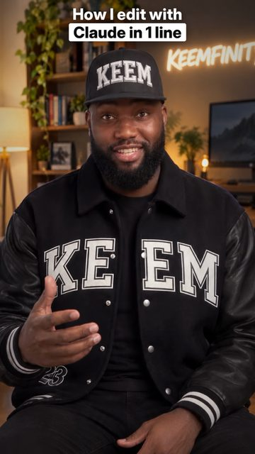<br><code>headline-box</code><br><sub>A punch-in with a two-line headline, second line boxed</sub></td><td align="center" valign="top" width="25%">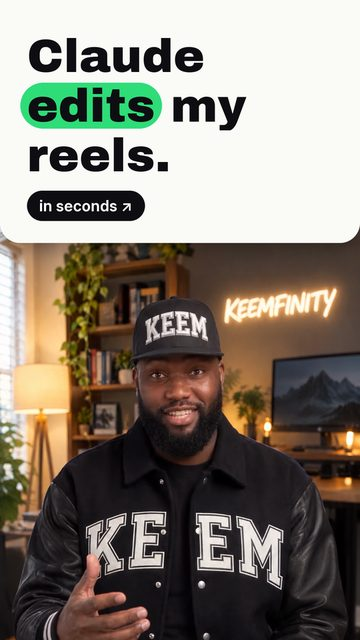<br><code>split-headline</code><br><sub>A headline card slides down and pushes you to the bottom half</sub></td><td align="center" valign="top" width="25%">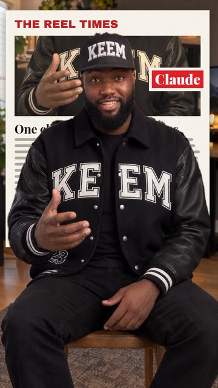<br><code>match-cut</code><br><sub>News pages flash by, all locked on one word behind you</sub></td><td align="center" valign="top" width="25%">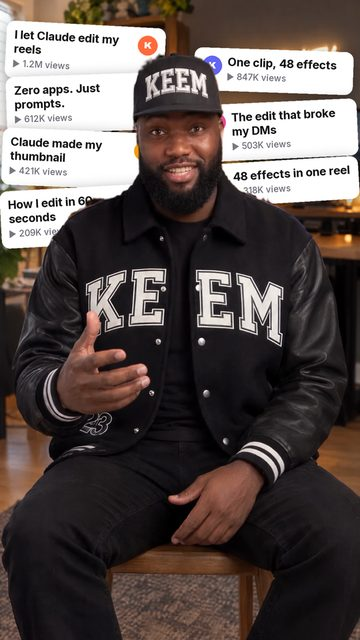<br><code>headline-wall</code><br><sub>Your past headlines stack up behind you, then your total views land</sub></td></tr>
<tr><td align="center" valign="top" width="25%">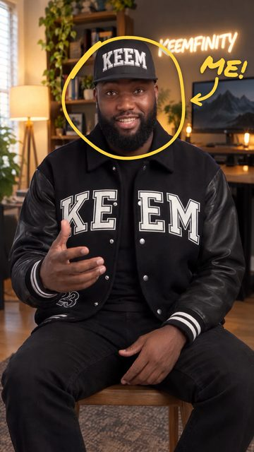<br><code>scribble</code><br><sub>Marker doodles draw themselves around you</sub></td><td align="center" valign="top" width="25%">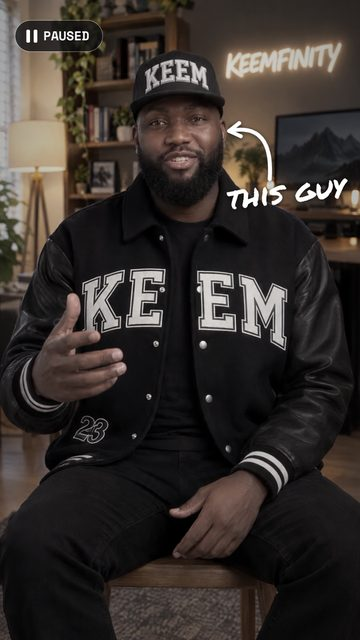<br><code>pause-point</code><br><sub>Freeze frame plus a hand-drawn arrow pointing at you</sub></td><td align="center" valign="top" width="25%">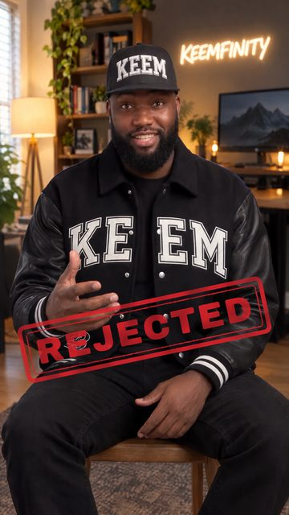<br><code>reject-stamp</code><br><sub>A big red stamp slams down</sub></td></tr>
</table>

### Your Reels
Show off your feed. Point it at a folder of your screenshots or clips.

<table>
<tr><td align="center" valign="top" width="25%">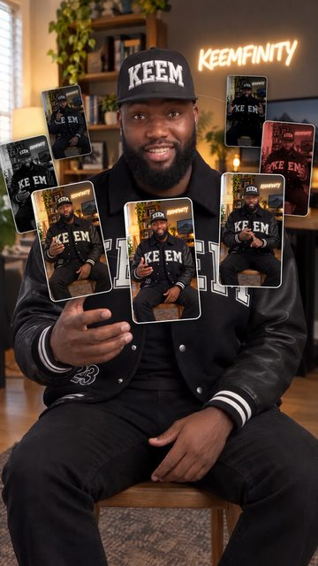<br><code>orbit</code><br><sub>Your reels orbit your head, in front at the bottom, behind at the top</sub></td><td align="center" valign="top" width="25%">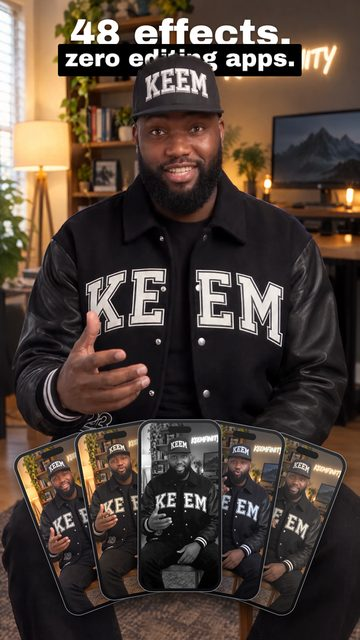<br><code>phone-fan</code><br><sub>Your reels fan out in front of you like a hand of phones</sub></td><td align="center" valign="top" width="25%">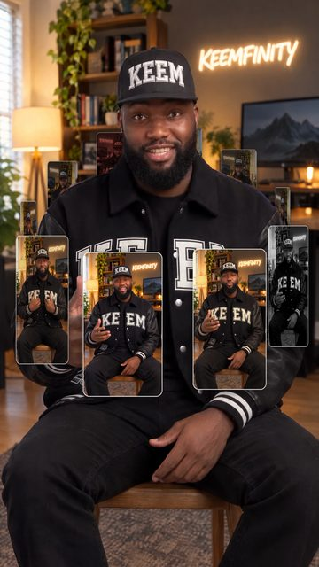<br><code>carousel-spin</code><br><sub>Your reels spin around you in 3D, then slow to a stop</sub></td><td align="center" valign="top" width="25%">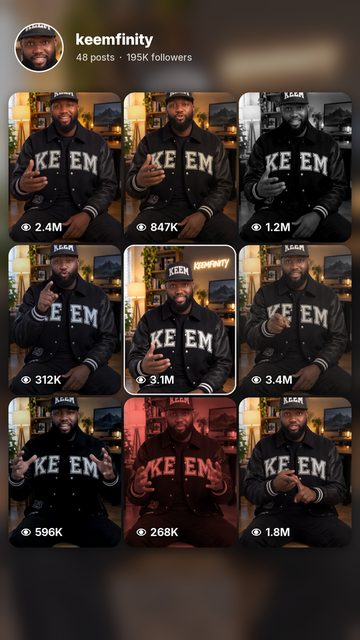<br><code>place-in-grid</code><br><sub>You shrink into the middle of your 3x3 grid as your reels pop in around you</sub></td></tr>
<tr><td align="center" valign="top" width="25%">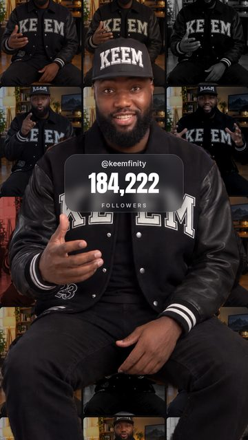<br><code>profile-wall</code><br><sub>Your profile grid fills the wall while a counter ticks up</sub></td><td align="center" valign="top" width="25%">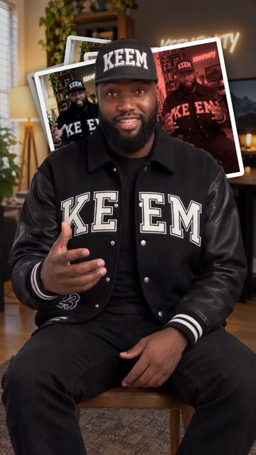<br><code>noise</code><br><sub>Reels pile up behind your head, four a second</sub></td><td align="center" valign="top" width="25%">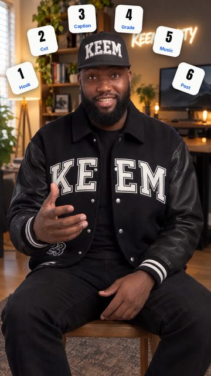<br><code>lineup</code><br><sub>Numbered tiles fan out in an arc above your head</sub></td><td align="center" valign="top" width="25%">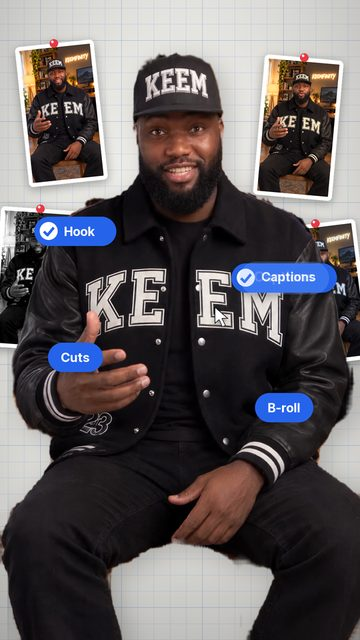<br><code>check-pills</code><br><sub>Grid-paper studio, reels pinned up, blue pills get clicked</sub></td></tr>
<tr><td align="center" valign="top" width="25%"><br><code>reel-frame</code><br><sub>Your video shrinks into an Instagram reel card</sub></td><td align="center" valign="top" width="25%">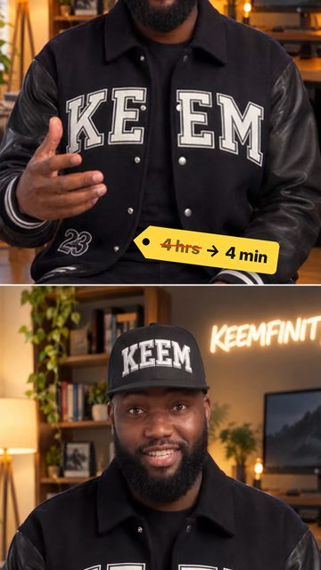<br><code>broll-split</code><br><sub>B-roll up top with a price-tag sticker, you below</sub></td></tr>
</table>

### Claude At Work
Show the AI doing the edit.

<table>
<tr><td align="center" valign="top" width="25%">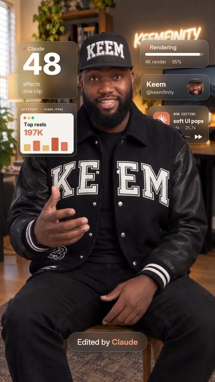<br><code>glass-widgets</code><br><sub>Frosted glass widgets float around your head, with an "Edited by Claude" pill</sub></td><td align="center" valign="top" width="25%">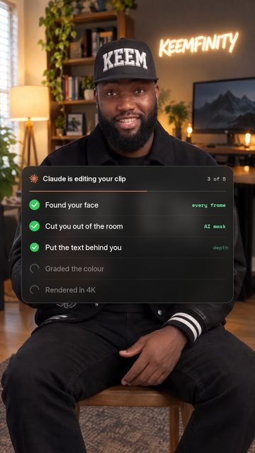<br><code>checklist</code><br><sub>A Claude task list builds under your chin, each step ticks green</sub></td><td align="center" valign="top" width="25%">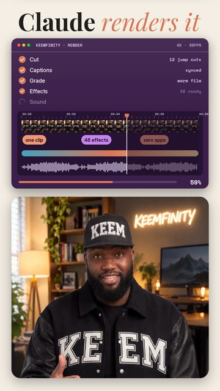<br><code>render-split</code><br><sub>"Claude renders it": a purple render window with tracks and a moving playhead, you below</sub></td><td align="center" valign="top" width="25%">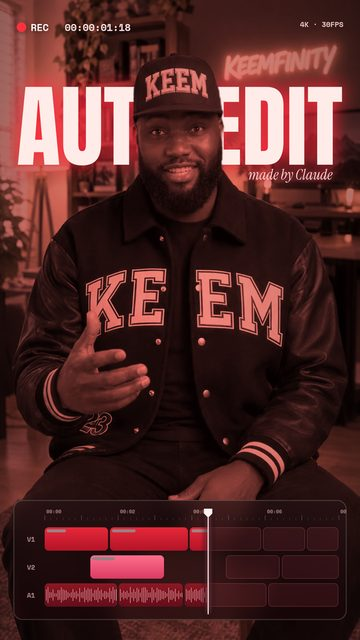<br><code>timeline</code><br><sub>A red cinematic grade with an editing timeline and REC timecode</sub></td></tr>
<tr><td align="center" valign="top" width="25%">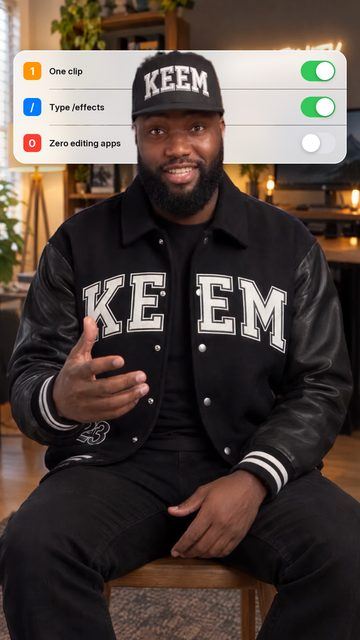<br><code>apple-toggles</code><br><sub>iPhone switches flip on one line at a time</sub></td><td align="center" valign="top" width="25%">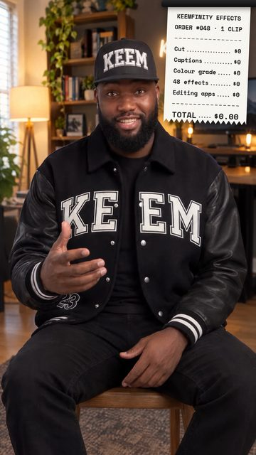<br><code>the-bill</code><br><sub>Your prompt prints out like a receipt</sub></td><td align="center" valign="top" width="25%">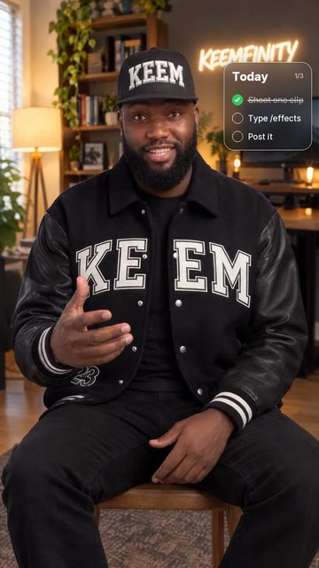<br><code>todo</code><br><sub>A checklist card beside your head ticks off as you talk</sub></td><td align="center" valign="top" width="25%">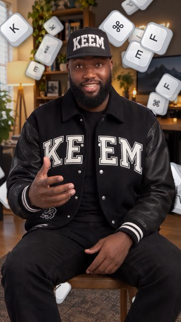<br><code>shortcut-rain</code><br><sub>Keyboard keys rain down behind you</sub></td></tr>
<tr><td align="center" valign="top" width="25%">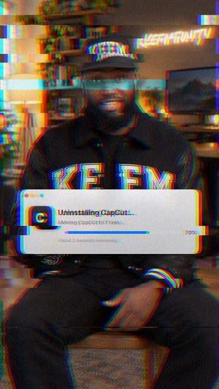<br><code>uninstall</code><br><sub>A glitchy uninstall bar breaks the frame apart</sub></td></tr>
</table>

### Social
The engagement moments.

<table>
<tr><td align="center" valign="top" width="25%">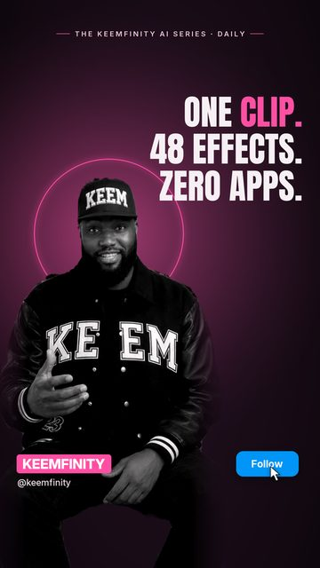<br><code>documentary</code><br><sub>Docu-series look: black-and-white you, pink halo, bold lines and a Follow button that gets tapped</sub></td><td align="center" valign="top" width="25%">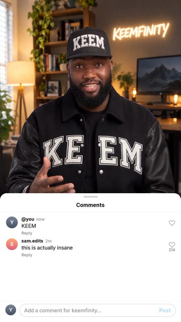<br><code>comment-box</code><br><sub>An Instagram comment types your word and posts it</sub></td><td align="center" valign="top" width="25%">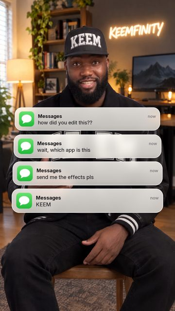<br><code>messages</code><br><sub>iMessage notifications stack up: "how did you edit this??"</sub></td><td align="center" valign="top" width="25%">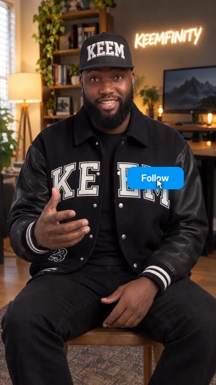<br><code>tap</code><br><sub>A Follow button pops up and flips to Following</sub></td></tr>
</table>

### Numbers
Charts and counters. Use your real numbers.

<table>
<tr><td align="center" valign="top" width="25%">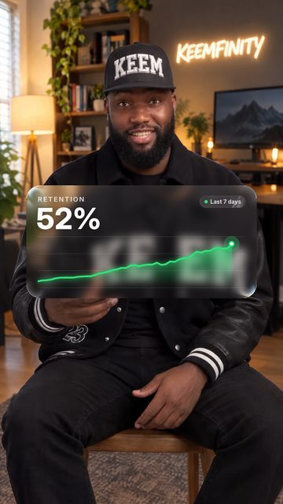<br><code>liquid-glass-graph</code><br><sub>A liquid glass card with a graph that climbs as the number counts up</sub></td><td align="center" valign="top" width="25%">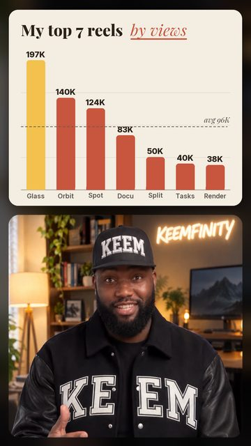<br><code>chart-split</code><br><sub>A cream bar chart of your top reels drops over the top half, you below</sub></td><td align="center" valign="top" width="25%">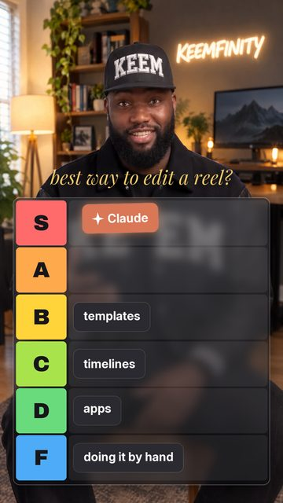<br><code>tier-list</code><br><sub>A tier list drops in and Claude flies into S tier</sub></td><td align="center" valign="top" width="25%">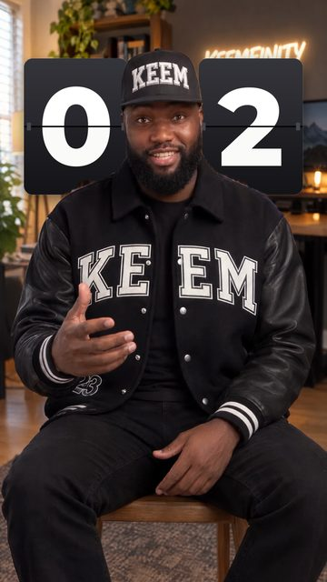<br><code>countdown-flip</code><br><sub>A 3, 2, 1 flip clock above your head</sub></td></tr>
</table>

## Pro moves

- **Vertical, well-lit, you in frame.** That's the sweet spot.
- **Say timing like a human.** "When I say *watch this*" works; Claude finds the exact second.
- **Bring your own reels.** Give Claude a folder of screenshots for `orbit`, `phone-fan`, `carousel-spin`, `place-in-grid` and friends.
- **Real numbers only.** Charts and counters should show your actual stats. Tell Claude what they are.
- **4K.** Ask for it. It's slower, but it's there.
- **Pro cut-out.** Soft edges around your hair or cap? Ask for the pro cut-out. Claude builds a hair-level matte first (BiRefNet, best on an NVIDIA GPU), and every effect uses it.

## Good to know

- This is a fast first draft, not a hand-keyed edit. Watch it before you post.
- Visuals only: add music and captions in your editor of choice.
- Something off? Just say it ("the word covers my chin", "make it faster") and Claude re-renders.

New effects drop on [@keemfinity](https://instagram.com/keemfinity).

## Licences

Keemfinity Effects is MIT licensed (see `LICENSE`). Bundled third-party files keep their own licences: face detection [OpenCV YuNet](https://github.com/opencv/opencv_zoo) (MIT) and person cut-out [MediaPipe Selfie Segmenter](https://ai.google.dev/edge/mediapipe/solutions/vision/image_segmenter) (Apache 2.0), see `models/NOTICE.md`; fonts Anton, Archivo Black, Inter, Montserrat, Playfair Display, Instrument Serif, Space Mono (SIL OFL) and Permanent Marker (Apache 2.0), see `fonts/`. The optional pro cut-out uses [BiRefNet](https://github.com/ZhengPeng7/BiRefNet) (MIT) via [rembg](https://github.com/danielgatis/rembg) (MIT).
