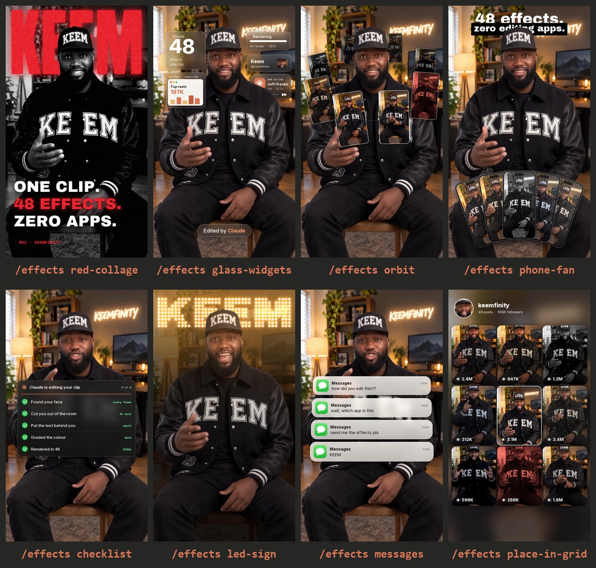

# Keemfinity Effects

**48 video effects for Claude.** Drop in a talking-head clip, type `/effects` and a name, and Claude does the edit. No editing app, no timeline, no templates.



Made by **Keemfinity** · [@keemfinity](https://instagram.com/keemfinity)

---

## Get it in 30 seconds

Paste this into your terminal (Mac, Linux, or Git Bash on Windows):

```bash
git clone https://github.com/keemfinity/keemfinity-effects ~/.claude/skills/effects
```

Restart Claude Code, and `/effects` is ready.

Not a terminal person? Open Claude Code and say: **"Install the skill from github.com/keemfinity/keemfinity-effects into ~/.claude/skills/effects"**. Claude installs it for you.

## Your first edit

Drag a video into Claude Code and ask for what you want:

```
/effects red-collage for the first 2 seconds, word KEEM
/effects led-sign when I say "lights out"
/effects orbit from 4 to 7 seconds with my reels from ./screenshots
/effects messages at the end
```

Claude finds the timing, checks a few frames so nothing covers your face, then renders `yourvideo_effects.mp4` next to your original, with your audio untouched. The first run sets itself up (Python and ffmpeg); give it two minutes.

Stack as many as you like in one sentence: *"red-collage at the start, then glass-widgets, then place-in-grid on the last line."*

## The 48 effects

Every effect tracks your face. Text and graphics slide behind your head instead of over it.

### Camera & Light
Move the camera, change the light, change the mood.

| Effect | What you get |
|---|---|
| `locked-on` | Brackets snap onto your face and the camera tracks you |
| `lean-in` | A hard punch-in on one word |
| `slow-push` | A slow cinematic push to your face while the room melts away |
| `over-the-shoulder-zoom` | The camera dives into one corner with a glass graph, then the other corner with a second graph |
| `spotlight` | Lights out, you stay lit, a glowing word behind you |
| `led-sign` | The room goes dark and an LED bulb sign types your word behind you |
| `moody` | One-tap colour grade: moody, black and white, warm, cool or pop |
| `swipe` | A before/after slider wipes across you |
| `dot-reveal` | Your shot assembles itself out of glowing dots |
| `rabbit-hole` | The frame tunnels into itself and spins |

### Words Behind You
Big type that sits behind your head, never over your face.

| Effect | What you get |
|---|---|
| `backdrop-word` | One giant word drops in behind you |
| `red-collage` | Black-and-white you, a red word behind, three lines slam in |
| `pastel-word` | A lavender set, a giant word, and a profile card that gets followed |
| `cover-star` | You become a magazine cover with the masthead behind your head |
| `headline-box` | A punch-in with a two-line headline, second line boxed |
| `split-headline` | A headline card slides down and pushes you to the bottom half |
| `match-cut` | News pages flash by, all locked on one word behind you |
| `headline-wall` | Your past headlines stack up behind you, then your total views land |
| `scribble` | Marker doodles draw themselves around you |
| `pause-point` | Freeze frame plus a hand-drawn arrow pointing at you |
| `reject-stamp` | A big red stamp slams down |

### Your Reels
Show off your feed. Point it at a folder of your screenshots or clips.

| Effect | What you get |
|---|---|
| `orbit` | Your reels orbit your head, in front at the bottom, behind at the top |
| `phone-fan` | Your reels fan out in front of you like a hand of phones |
| `carousel-spin` | Your reels spin around you in 3D, then slow to a stop |
| `place-in-grid` | You shrink into the middle of your 3x3 grid as your reels pop in around you |
| `profile-wall` | Your profile grid fills the wall while a counter ticks up |
| `noise` | Reels pile up behind your head, four a second |
| `lineup` | Numbered tiles fan out in an arc above your head |
| `check-pills` | Grid-paper studio, reels pinned up, blue pills get clicked |
| `reel-frame` | Your video shrinks into an Instagram reel card |
| `broll-split` | B-roll up top with a price-tag sticker, you below |

### Claude At Work
Show the AI doing the edit.

| Effect | What you get |
|---|---|
| `glass-widgets` | Frosted glass widgets float around your head, with an "Edited by Claude" pill |
| `checklist` | A Claude task list builds under your chin, each step ticks green |
| `render-split` | "Claude renders it": a purple render window with tracks and a moving playhead, you below |
| `timeline` | A red cinematic grade with an editing timeline and REC timecode |
| `apple-toggles` | iPhone switches flip on one line at a time |
| `the-bill` | Your prompt prints out like a receipt |
| `todo` | A checklist card beside your head ticks off as you talk |
| `shortcut-rain` | Keyboard keys rain down behind you |
| `uninstall` | A glitchy uninstall bar breaks the frame apart |

### Social
The engagement moments.

| Effect | What you get |
|---|---|
| `documentary` | Docu-series look: black-and-white you, pink halo, bold lines and a Follow button that gets tapped |
| `comment-box` | An Instagram comment types your word and posts it |
| `messages` | iMessage notifications stack up: "how did you edit this??" |
| `tap` | A Follow button pops up and flips to Following |

### Numbers
Charts and counters. Use your real numbers.

| Effect | What you get |
|---|---|
| `liquid-glass-graph` | A liquid glass card with a graph that climbs as the number counts up |
| `chart-split` | A cream bar chart of your top reels drops over the top half, you below |
| `tier-list` | A tier list drops in and Claude flies into S tier |
| `countdown-flip` | A 3, 2, 1 flip clock above your head |

## Pro moves

- **Vertical, well-lit, you in frame.** That's the sweet spot.
- **Say timing like a human.** "When I say *watch this*" works; Claude finds the exact second.
- **Bring your own reels.** Give Claude a folder of screenshots for `orbit`, `phone-fan`, `carousel-spin`, `place-in-grid` and friends.
- **Real numbers only.** Charts and counters should show your actual stats. Tell Claude what they are.
- **4K.** Ask for it. It's slower, but it's there.
- **Pro cut-out.** Soft edges around your hair or cap? Ask for the pro cut-out. Claude builds a hair-level matte first (BiRefNet, best on an NVIDIA GPU), and every effect uses it.

## Good to know

- This is a fast first draft, not a hand-keyed edit. Watch it before you post.
- Visuals only: add music and captions in your editor of choice.
- Something off? Just say it ("the word covers my chin", "make it faster") and Claude re-renders.

New effects drop on [@keemfinity](https://instagram.com/keemfinity).

## Licences

Keemfinity Effects is MIT licensed (see `LICENSE`). Bundled third-party files keep their own licences: face detection [OpenCV YuNet](https://github.com/opencv/opencv_zoo) (MIT) and person cut-out [MediaPipe Selfie Segmenter](https://ai.google.dev/edge/mediapipe/solutions/vision/image_segmenter) (Apache 2.0), see `models/NOTICE.md`; fonts Anton, Archivo Black, Inter, Montserrat, Playfair Display, Instrument Serif, Space Mono (SIL OFL) and Permanent Marker (Apache 2.0), see `fonts/`. The optional pro cut-out uses [BiRefNet](https://github.com/ZhengPeng7/BiRefNet) (MIT) via [rembg](https://github.com/danielgatis/rembg) (MIT).
